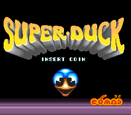
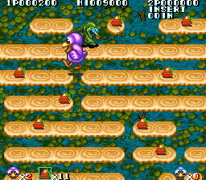

# Super Duck (Comad) for MiSTer

MAME's `capcom/supduck.cpp` driver, Comad's 1992 board "roughly based off Bionic Commando, close to the Tiger Road / F1-Dream based
Pushman / Bouncing Balls" (68000 at 8 MHz; Z80 at 2 MHz with an OKI M6295 and four banks of samples; two 128 x 64 tilemaps of
32 x 32 tiles, Capcom's Tiger Road sprites and an 8 x 8 text layer), for the MiSTer FPGA platform:

| Game | Set | MRA |
|---|---|---|
| Super Duck (1992) | `supduck` | `mra/Super Duck.mra` |

| Title | In play |
|---|---|
|  |  |

Pictures from MAME 0.289; the core draws the same pictures (`docs/status.md`).

Written for MiSTer from MAME 0.289's driver and its sprite generator (`tigeroad_spr.cpp`), on the owner's Silver Millennium core
(the same platform layer: `rtl/UPSTREAM.md`). The 68000 is [fx68k](https://github.com/ijor/fx68k) (Jorge Cwik), the Z80 is
[TV80](https://github.com/hoglet67/tv80) (Guy Hutchison), the OKI M6295 [jt6295](https://github.com/jotego/jt6295) (Jose Tejada),
the CRT Adjust page is rmonic79's [MiSTer-CRT-Adjust](https://github.com/rmonic79/MiSTer-CRT-Adjust). The platform layer (SDRAM
controller, loader, program cache, fast load, Scale) is the owner's, from the Silver Millennium, Cross Pang, Oh My God!, MCatAdv and
Metro cores; the SDRAM controller descends from the Gaiapolis core that **plasticbugs** wrote for the Analogue Pocket. No ROMs or
other copyrighted data are in this repository; you supply your own MAME romset.

## Status

Runs well on the owner's MiSTer.  See `docs/status.md` for that test and for what was checked and how, against MAME 0.289, in
simulation and in the Quartus tool flow.

## Install

1. Unzip `SuperDuck_MiSTer_<date>.zip` (from the GitHub release) over the root of the SD card: it puts the MRA in `_Arcade/` and the
   core in `_Arcade/cores/`. From the repository instead: `releases/supduck_YYYYMMDD.rbf` to `/media/fat/_Arcade/cores/` and
   `mra/Super Duck.mra` to `/media/fat/_Arcade/`. Keep the RBF's `supduck_` name and date: MiSTer finds the core by the MRA's
   `<rbf>` name plus the date. Delete older `supduck_*.rbf` files.
2. Put your MAME 0.289 romset in `/media/fat/games/mame/`: `supduck.zip`.
3. Start the game from the Arcade menu. With a recent Main_MiSTer the ROM loads in a moment (fast loading: the MRA's `address=` makes
   Main_MiSTer copy the image into the DDR3, the core reads it back); an older Main_MiSTer ignores it and loads the ordinary way.
4. Define the buttons once (OSD): the MRA names them, in the order Shot, Jump, Start, Coin.

## Controls

A 4-way joystick per player (MAME's `PORT_4WAY`: the core filters diagonals as MAME does), two buttons, Start and Coin; on the
keyboard, MAME's defaults (1 / 2 start, 5 / 6 coin).

| Button 1 | Button 2 |
|---|---|
| **Shot**: a shot straight up from the duck -- the game acts on it only in some states (in the opening play MAME shows no effect) | **Jump**: the duck jumps to the next platform |

MAME 0.289's INPUT_PORTS give each player four buttons; the game's input routine reads only the first two (buttons 3 and 4 appear
only in the service mode's input test), so only those are mapped. The names come from the game's code and pressing each button in
MAME (`docs/status.md`).

There is no service button: for the test mode set the **Service Mode** DIP switch and reset the core (as in MAME).

## OSD

* **Aspect ratio**, **Scale** (Normal, V-Integer, HV-Integer, Narrower HV-Integer, HV-Integer+): for the HDMI scaler; with Full
  Screen and an integer Scale the screen's own proportions stand in, so the picture stays a whole-number size.
* **Scandoubler Fx** (HQ2x, CRT 25 / 50 / 75 %): the framework's.
* **CRT Adjust** (H-Size, H-Position, V-Shift): for the 15 kHz output, through rmonic79's line buffer; the horizontal sync stays
  native so the CRT keeps its lock. It is off while the scandoubler is in use (Scandoubler Fx or MiSTer.ini's `forced_scandoubler`):
  its blanking would leave the doubled picture without a vertical sync.
* **DIP switches**: MAME 0.289's, with MAME's defaults; the multi-bit ones (Coinage, Lives) as bit ranges with every setting. Reset
  after a change.
* **Volume**: Normal is MAME's level (the OKI at route 1.0, clipped to 16 bits), then 6 / 12 / 18 dB lower.
* **Video RAM**: *At vblank (MAME)* (default) copies the tile RAMs and the scroll registers at the start of vertical blank and draws
  the next frame from the copy, as MAME draws a frame. *Live (less lag)* reads them as each line is drawn: the scroll and the
  sprites (from the newest copy of the board's sprite buffer) show a frame earlier, together; a text change (the score) or a
  scene change's tilemap rewrite can show half done for one frame, as the game writes them while the picture is drawn
  (`docs/status.md`). The palette is always looked up as the dots go out.

## Timing

96 MHz machine clock; 68000 8 MHz, Z80 2 MHz, OKI 1 MHz (pin 7 high), dot clock 6 MHz -- all from the board's 8 MHz crystal, all
exact divisions of 96 MHz. The raster is MAME's: 384 x 262 total, 256 x 224 visible, 15.625 kHz, 59.637 Hz, with the sync pulses
where the driver's notes put them (dots 306..333, lines 251..253).

## Build

Quartus Prime Lite 17.0 (MiSTer's toolchain): open `SuperDuck.qpf` or `quartus_sh --flow compile SuperDuck`. The MRA is written by
`python tools/make_mra.py` (it reads MAME 0.289's romset and `src/mame/capcom/supduck.cpp`; `tools/paths.py` says where).

## Simulation (Verilator 5 in WSL)

```
sim/run.sh <image> 0 <out> +state=<MAME state prefix>                 # one frozen MAME state, vs MAME's pixels (<out>.ppm)
sim/run.sh <image> <frames> <out> +inputs=<replay> +wav               # the whole machine from reset with MAME's inputs
sim/run.sh <image> 0 <out> +load=fast                                 # the fast load from a DDR3 model, checked word by word
sim/sd/sweep.sh                                                       # the framework's scandoubler, with CRT Adjust
```
`python tools/supduck_image.py build <out.rom>` makes an image (the bytes the MRA delivers). `tools/capture.py` with
`tools/lua/dump_state.lua` makes MAME 0.289's states and input replays; `tools/supduck_ref.py` (a reference renderer written from the
driver), `tools/corpus_rtl.py`, `tools/sys_match.py` and `tools/cmp_audio.py` compare; `tools/probe.py` presses inputs in MAME. They
expect a scratch folder `work/` next to the repository (MAME's dumps and the ROM image; never committed); `tools/paths.py` names the
environment variables for MAME, the romset and MAME's source.

## Release

`python tools/release.py` copies a finished build into `releases/` with its fitter / timing / RAM-depth reports;
`python tools/package.py` writes `dist/SuperDuck_MiSTer_<date>.zip` (the SD card structure: `_Arcade/*.mra`,
`_Arcade/cores/*.rbf`; no ROMs).

## Credits

* **MAME** (the supduck driver and the Tiger Road sprite device by David Haywood; BSD-3-Clause): the hardware knowledge, the oracle
  for every comparison, and the reference renderer's logic.
* **Jorge Cwik**: fx68k (the 68000), GPL-3.0.
* **Guy Hutchison**: tv80 (the Z80), MIT.
* **Jose Tejada (jotego)**: jt6295 (OKI M6295), GPL-3.0.
* **Umberto Parisi (rmonic79)**: MiSTer-CRT-Adjust (`modules/crt_adjust`, GPL-3.0-or-later).
* **plasticbugs**: the Pocket Gaiapolis core's SDRAM controller and `mra_build.py`.
* **The MiSTer framework** (Sorgelig and contributors); the loader, cache, fast loading and Scale follow the owner's other cores
  (Silver Millennium, Cross Pang, Oh My God!, MCatAdv, Metro).

## Licence

GPL-3.0-or-later (fx68k and jt6295 are GPL-3.0, TV80 is MIT, MiSTer-CRT-Adjust GPL-3.0-or-later).
